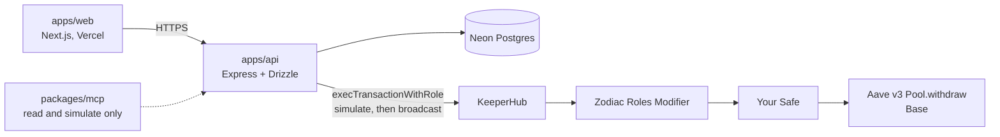

<div align="center">

# Exit Keepa

**Rate-triggered protective exits for Aave v3 positions held in your own Safe.**

You set the condition, Exit Keepa watches the rate, and KeeperHub executes a withdraw that can only return funds to your Safe. The agent never holds your keys.

[Web app](https://exit-keepa-web.vercel.app) · [On-chain proof](https://basescan.org/tx/0xc8a00cc28bf116acea722ab298d610bdbfc50a05b902aae5ab74d9da1849fd8b) · [Demo video](https://youtu.be/WzgAuy__2Qo) · [Submission](docs/SUBMISSION.md)

[](https://github.com/levithefirst/exit-keepa/actions/workflows/ci.yml)


</div>

> "If the monitored rate crosses my threshold, withdraw my position back to my Safe."

Exit Keepa turns that sentence into a policy-checked, simulated, then broadcast `withdraw` on Base. Aave v3 and Gnosis Safe are the systems the user already uses. Zodiac Roles limits what the executor may call. [KeeperHub](https://app.keeperhub.com) is the execution layer. It was built for KeeperHub's [Agent Economy hackathon](https://dorahacks.io/hackathon/agent-economy/detail).

> [!WARNING]
> Exit Keepa targets **Base mainnet** (chain `8453`) and real funds. In production the API's background poller is **on by default**, and it broadcasts automatically when a condition crosses and the simulation passes. Read [How execution is authorized](#how-execution-is-authorized) before you point it at a Safe you care about.

> [!NOTE]
> **Deployment status, checked 2026-10-26:** the Railway API (`api-production-2e11.up.railway.app`) returns `404 Application not found`, so live strategies, the demo sandbox and `/api/live-proof` do not work. The Vercel web app still loads, but it is an older build: `/audit` returns 404 there even though the page exists in this branch. The on-chain proof needs no server and is still verifiable on BaseScan.

## Contents

- [Quick look](#quick-look)
- [What it does (v1 scope)](#what-it-does-v1-scope)
- [How execution is authorized](#how-execution-is-authorized)
- [User flow](#user-flow)
- [Live proof](#live-proof)
- [Agent surfaces](#agent-surfaces)
- [The broadcast flag](#the-broadcast-flag)
- [Architecture](#architecture)
- [Run it locally](#run-it-locally)
- [Configuration](#configuration)
- [Testing](#testing)
- [Deployment](#deployment)
- [Known limitations](#known-limitations)
- [Further reading](#further-reading)
- [License](#license)

## Quick look

```bash
npm install
npm run judge            # runs the suites and prints real counts
npm run judge -- --fast  # skips the suites
```

`scripts/judge.mjs` prints the following, all worked out from the code rather than copied from this file:

- the live-proof transaction and execution id
- the live URLs, with a real health probe
- the agent surfaces
- whether broadcasting is enabled
- the test counts

## What it does (v1 scope)

v1 supports exactly one protocol action: an **Aave v3 USDC `withdraw` on Base**.

| | |
|---|---|
| Aave v3 Pool | `0xA238Dd80C259a72e81d7e4664a9801593F98d1c5` |
| Asset | USDC `0x833589fCD6eDb6E08f4c7C32D4f71b54bdA02913` |
| Function | `withdraw(address,uint256,address)`, selector `0x69328dec` |
| Recipient | always the Safe itself |
| Trigger | live Aave supply or borrow rate crossing your threshold |

The `withdraw` call is encoded in a single place, [`packages/shared/src/protocols/aaveV3Base.ts`](packages/shared/src/protocols/aaveV3Base.ts), which throws rather than encode anything for a non-USDC asset.

## How execution is authorized

```
Safe  →  Zodiac Roles Modifier  →  execTransactionWithRole  →  Safe executes
```

KeeperHub executes, but it can only call `execTransactionWithRole` on your Roles Modifier, and **a role permits nothing by default**. The fully scoped permission for Exit Keepa takes two steps:

1. `scopeTarget(roleKey, AavePool)`. This changes the Pool's clearance from `None` to `Function`, so no function on it is callable yet.
2. `scopeFunction(roleKey, AavePool, 0x69328dec, conditions, None)`. This allows `withdraw` only when `asset == USDC` and `to == the Safe`. `amount` is left unrestricted, and value and delegatecall are not allowed.

Both steps are live on the live-proof Safe. The owner submitted them in tx [`0x41d61e34…e81f1`](https://basescan.org/tx/0x41d61e34a1e94ea693a3c6c2fc86e5fcc6c845a9b692fe86a9363e761e6e81f1), and the full verification record is in [`docs/ROLES_TIGHTENING.md`](docs/ROLES_TIGHTENING.md).

On top of the Roles Modifier, Exit Keepa runs its own policy check in [`apps/api/src/agent/policy.ts`](apps/api/src/agent/policy.ts). It confirms the right chain, contract, function and asset, that funds return only to your Safe, and that Roles is configured. The two layers are meant to work together as defense in depth.

> [!NOTE]
> The live-proof Safe may still show a `Wildcard` clearance on the Safe's own address in its Roles config. It is left over from earlier demo setup and grants nothing against the Aave Pool. The earlier harmless self-call through this path is [`0xf2122ab5…1278c`](https://basescan.org/tx/0xf2122ab591a73f81c1d1290f4830d5576866e0a5e817d9687450f2b11481278c).

## User flow

1. **Connect a wallet.** Any EIP-1193 injected wallet works. Sign-in is SIWE-style: you sign a one-time nonce and receive a bearer session, and every Safe, strategy or execution route checks the `safe_owners` table.
2. **Connect a Safe** on the dashboard, along with its Roles Modifier address and role key if you have them.
3. **Create a strategy.** Pick the trigger condition and the amount, either the entire position or an exact amount.
4. **Review the exact transaction.** The page shows the target, function, decoded arguments and raw calldata. The server rebuilds all of this from the stored strategy and never trusts calldata from the frontend.
5. **Activate.** This is your last step.
6. **Exit Keepa watches.** The poller ([`agent/poller.ts`](apps/api/src/agent/poller.ts)) reads the live Aave rate on every tick. On a genuine edge crossing it claims one attempt atomically and runs the policy check. If the check fails, the attempt is marked `refused` with a reason and nothing reaches KeeperHub.
7. **Simulate, then broadcast.** Exit Keepa runs `execTransactionWithRole` with `simulate: true` first. If the simulation would revert, it stops with `failed`. If it passes, the same call is sent immediately with `simulate: false` and an `Idempotency-Key`. Both the autonomous path and the manual recovery endpoint go through [`execution/executeApproved.ts`](apps/api/src/execution/executeApproved.ts).
8. **Verify.** Exit Keepa polls KeeperHub's execution status with backoff. A transaction hash is stored only once a receipt confirms it. An outcome it can't confirm is shown as *"Execution status is being verified"*.

The nav bar also has **Try demo**, which runs this flow against a sandbox Safe with no wallet extension. It needs the API to be up.

## Live proof

A real Aave v3 USDC withdraw went end to end through this path on Base mainnet. It is part of the chain's history; you can check it but you can't re-run it.

| | |
|---|---|
| Tx | [`0xc8a00cc28bf116acea722ab298d610bdbfc50a05b902aae5ab74d9da1849fd8b`](https://basescan.org/tx/0xc8a00cc28bf116acea722ab298d610bdbfc50a05b902aae5ab74d9da1849fd8b) |
| Result | receipt status `0x1`; USDC moved from Aave back to the Safe |
| Safe | `0xfFd5c5e17e09E012C99550Bfb2ef88d370cd66a9` |
| Roles Modifier | `0x694C3F6104741901F6AE0191Fd1afA9A274dBbBE` |
| KeeperHub executor | `0xc68f0E22Dc6eD7e883873B36f23DdBBC1b3968Ac` |

The canonical record lives in `packages/shared` and is served by `GET /api/live-proof` when the API is running. The app's own history row briefly showed `failed` because of a hash-extraction bug that has since been fixed. The chain is the source of truth.

## Agent surfaces

- **MCP server** ([`packages/mcp`](packages/mcp/README.md)) has five read-and-simulate tools over the API's own helpers: `evaluate_exit_condition`, `build_exit_calldata`, `simulate_exit`, `get_execution_status` and `get_live_proof`. It has **no broadcast tool**. Run it with:
  ```bash
  node packages/mcp/bin/exit-keepa-mcp.mjs
  ```
- **Workflow artifact** ([`docs/workflows/aave-usdc-protective-exit.json`](docs/workflows/aave-usdc-protective-exit.json)) describes the exit as a KeeperHub workflow: condition, then policy gate, then simulate, then a broadcast step that is disabled and env-gated. It is schema-checked in tests and has never been registered or executed.
- **Public audit API.** `GET /api/live-proof` recomputes the policy check on each request and needs no session.

## The broadcast flag

`EXIT_KEEPA_ALLOW_BROADCAST` is unset by default and only counts as on when it is exactly `"1"`. It gates the **MCP server** and the **workflow artifact's broadcast step**. The MCP server has no broadcast implementation at all, so setting the flag adds nothing there.

> [!IMPORTANT]
> The flag does **not** gate the API. `apps/api/src/execution/executeApproved.ts` is the one path that has ever broadcast, and it produced the live proof. It is controlled by the poller (`AGENT_POLL_ENABLED`) and by the Safe's Roles scope, not by `EXIT_KEEPA_ALLOW_BROADCAST`.

## Architecture



```
apps/web         Next.js 14 (App Router): wallet connect, dashboard, strategy CRUD, audit trail
apps/api         Express + Drizzle ORM on Postgres: poller, policy, state machine, KeeperHub client
packages/shared  Types, Zod schemas, Aave v3 Base module, live-proof record, workflow schema
packages/mcp     MCP server: read-and-simulate adapter over apps/api's execution helpers
```

| File | Role |
|---|---|
| [`apps/api/src/execution/buildTransaction.ts`](apps/api/src/execution/buildTransaction.ts) | The only place a stored strategy becomes a transaction |
| [`apps/api/src/execution/executor.ts`](apps/api/src/execution/executor.ts) | Calls KeeperHub with `simulate: true`/`false`; accepts only well-formed hashes |
| [`apps/api/src/execution/stateMachine.ts`](apps/api/src/execution/stateMachine.ts) | Broadcast idempotency via a conditional `UPDATE … WHERE status = 'simulated'` |
| [`apps/api/src/auth/session.ts`](apps/api/src/auth/session.ts) | Session and Safe-ownership checks |

More detail: [`docs/architecture.md`](docs/architecture.md) and [`docs/keeperhub-integration.md`](docs/keeperhub-integration.md).

## Run it locally

Requires Node 20 or newer, a Postgres database and KeeperHub credentials.

```bash
npm install
npm run build --workspace packages/shared   # apps/api tests and runtime resolve shared's dist/

cp .env.example apps/api/.env
cp .env.example apps/web/.env.local          # web reads only NEXT_PUBLIC_API_URL
```

Fill in `apps/api/.env` and set `NEXT_PUBLIC_API_URL=http://localhost:4000` in `apps/web/.env.local`. Never commit either file.

> [!NOTE]
> The API does not load `.env` files by itself, because there is no dotenv in `apps/api`. Export the variables into your shell first, for example `set -a; . apps/api/.env; set +a`. Next.js loads `apps/web/.env.local` on its own.

```bash
npm run db:migrate   # Drizzle migrations in apps/api/drizzle
npm run dev:api      # http://localhost:4000, health at GET /health
npm run dev:web      # http://localhost:3000, health at GET /api/health
```

## Configuration

API variables are validated in [`apps/api/src/env.ts`](apps/api/src/env.ts). The template is [`.env.example`](.env.example).

| Variable | Required | Default | Purpose |
|---|---|---|---|
| `DATABASE_URL` | yes | none | Postgres connection string |
| `KEEPERHUB_API_KEY` | yes | none | KeeperHub API key |
| `KEEPERHUB_WEBHOOK_SECRET` | yes | none | Verifies KeeperHub webhooks |
| `KEEPERHUB_API_BASE_URL` | no | `https://app.keeperhub.com/api` | KeeperHub API base |
| `CORS_ORIGINS` | no | empty (no cross-origin access) | Comma-separated origins, or `*` |
| `BASE_CHAIN_ID` | no | `8453` | Base mainnet |
| `BASE_RPC_URL` | no | `https://mainnet.base.org` | Primary RPC; use a keyed endpoint in production |
| `BASE_RPC_FALLBACKS` | no | publicnode, 1rpc, drpc | Comma-separated fallback RPCs |
| `AGENT_POLL_ENABLED` | no | `true` when `NODE_ENV=production`, else `false` | Background watcher and auto-execution |
| `AGENT_POLL_INTERVAL_MS` | no | `30000` (min `5000`) | Poll interval |
| `AGENT_DECISION_MAX_AGE_MS` | no | `300000` | Max age of a decision before it is stale |
| `NODE_ENV` / `PORT` / `LOG_LEVEL` | no | `development` / `4000` / `info` | Runtime |
| `NEXT_PUBLIC_API_URL` | yes (web) | none | API base URL for the browser |
| `EXIT_KEEPA_ALLOW_BROADCAST` | no | unset | See [The broadcast flag](#the-broadcast-flag) |

## Testing

```bash
npm run build --workspace packages/shared   # needed once on a fresh clone
npm test                                    # shared + api + mcp
npm run typecheck
```

On 2026-10-26, a fresh clone of this branch gave the following results:

- **323 tests passed:** `packages/shared` 36, `apps/api` 254 and `packages/mcp` 33.
- `npm run typecheck` was clean.

Without the shared build step, the `apps/api` suites fail to resolve `@exit-keepa/shared`. CI ([`.github/workflows/ci.yml`](.github/workflows/ci.yml)) runs the following steps:

1. install
2. build shared
3. typecheck
4. lint
5. the three test suites
6. a full build

## Deployment

| Piece | Host | Config | Status (2026-10-26) |
|---|---|---|---|
| API | Railway | [`apps/api/railway.json`](apps/api/railway.json) | down: `404 Application not found` |
| Web | Vercel (`exit-keepa-web`) | [`docs/VERCEL_DEPLOY.md`](docs/VERCEL_DEPLOY.md) | up, but an older build without `/audit`; it still points at the Railway API |

## Known limitations

- **The hosted API is down.** As of 2026-10-26 the Railway API returns `404 Application not found`, so live strategies, the demo sandbox and `/api/live-proof` do not work, and the Vercel web app is an older build. The on-chain proof is still verifiable on BaseScan.
- **One action only.** v1 supports a single Aave v3 USDC `withdraw` on Base, and nothing else is encoded.
- **Real funds, automatic broadcast.** It targets Base mainnet, and in production the API poller is on by default and broadcasts when a condition crosses and the simulation passes.
- **`amount` is not restricted** by the Roles scope; only the asset (USDC) and the recipient (the Safe) are.
- **`EXIT_KEEPA_ALLOW_BROADCAST` does not gate the API**, only the MCP server and the workflow artifact.
- **The KeeperHub workflow artifact has never been registered or executed**, and the MCP server has no broadcast tool.

## Further reading

- [`docs/SUBMISSION.md`](docs/SUBMISSION.md) is the full hackathon write-up.
- [`docs/JUDGE_DEMO.md`](docs/JUDGE_DEMO.md) is the click-through, including `/audit` and **Try a blocked call**.
- [`docs/ROLES_TIGHTENING.md`](docs/ROLES_TIGHTENING.md) and [`docs/zodiac-verification-evidence.md`](docs/zodiac-verification-evidence.md) are the Roles verification records.
- [`docs/DEMO_VIDEO_SCRIPT.md`](docs/DEMO_VIDEO_SCRIPT.md) is the script behind the demo video.

## License

MIT. See [LICENSE](LICENSE).
